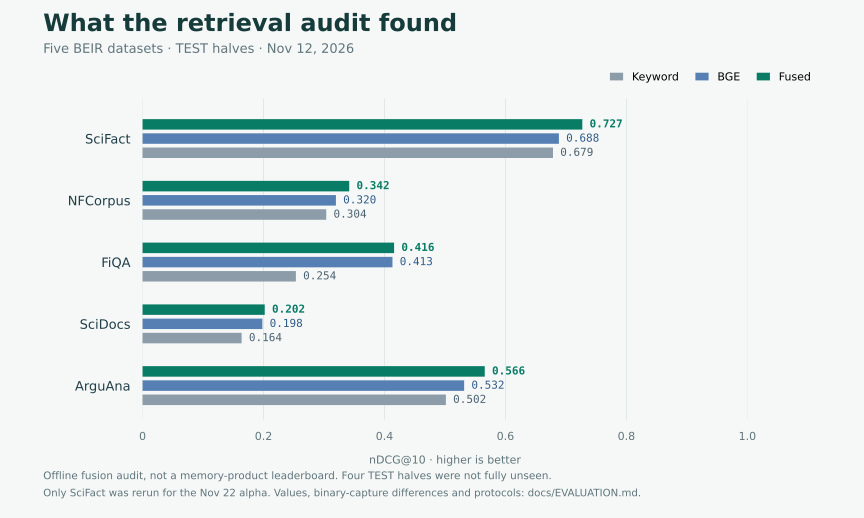

<p align="center">Find the right note. See whether the passage changed.</p>

<p align="center">
  <a href="https://github.com/kkamali04/lastknown/releases/tag/v0.1.0-alpha.1">Download the alpha</a> ·
  <a href="docs/TRY-IT.md">Try the demo</a> ·
  <a href="docs/MCP.md">Connect an agent</a> ·
  <a href="docs/EVALUATION.md">Read the evidence</a>
</p>
<p align="center">
  <a href="LICENSE"></a>
  <a href="https://github.com/kkamali04/lastknown/releases/tag/v0.1.0-alpha.1"></a>
</p>

Lastknown gives you and your coding agents a searchable memory of your Markdown notes.
It combines keyword and local semantic search, returns the source file, and checks whether
the retrieved passage still matches that file. Use it from a terminal, an MCP client, or
a local browser interface.

**Runs on your machine.** Default search needs no LLM, provider API key, or graph database.
Your existing notes remain the source of truth; the search index lives in local SQLite.
The executable is still named `recall`.

## Why use it?

- **Catch outdated context.** A result can distinguish an unchanged file, an edited file
  whose excerpt is still current, and an excerpt whose source lines changed.
- **Search by words and meaning.** SQLite FTS5 handles exact terms; BGE-small runs locally
  through ONNX Runtime. Their scores are combined into one ranked list.
- **Give agents access to evidence.** Read-only MCP tools expose search, recent memories,
  identity and health. Search text is passed as data, and failed backends report errors.
- **Keep the index maintainable.** Refresh changed notes and embeddings, inspect status,
  and apply pattern-based redaction to stored text and output.

The [portable demo](examples/stale-demo) changes a source note from port `8080` to `9090`,
shows the old excerpt as stale, then reindexes and retrieves the update. Freshness checks
source text; it does not establish factual truth. Changes confined to a redacted value
can be missed. [How freshness works →](docs/FRESHNESS.md)

## Get started

Download and extract **the entire archive** for your platform:

| Windows x64 | Linux x64 | Linux ARM64 | macOS Apple Silicon |
|---|---|---|---|
| [ZIP](https://github.com/kkamali04/lastknown/releases/download/v0.1.0-alpha.1/lastknown-windows-x64.zip) | [tar.gz](https://github.com/kkamali04/lastknown/releases/download/v0.1.0-alpha.1/lastknown-linux-x64.tar.gz) | [tar.gz](https://github.com/kkamali04/lastknown/releases/download/v0.1.0-alpha.1/lastknown-linux-arm64.tar.gz) | [tar.gz](https://github.com/kkamali04/lastknown/releases/download/v0.1.0-alpha.1/lastknown-macos-arm64.tar.gz) |

All four passed [native build and fresh-install checks](https://github.com/kkamali04/lastknown/actions/runs/45003961345).
Linux was tested on Ubuntu 24.04; macOS on macOS 15. Intel Mac and other targets are not validated.
[Platform details and checksums →](docs/PLATFORMS.md)

### Try it before installing

From the extracted folder, in a new PowerShell window, with ripgrep (`rg`) on PATH:

```powershell
powershell -NoProfile -ExecutionPolicy Bypass -File .\examples\stale-demo\run.ps1 -Bin .\prebuilt\release\recall.exe
```

On Linux/macOS:

```sh
sh examples/stale-demo/run.sh "$PWD/prebuilt/release/recall"
```

Expect **`stale-demo: PASS`**. It uses temporary notes and a temporary profile; it needs no
Rust compiler, Python, or model download. [Full installer/BGE/MCP acceptance check →](docs/TRY-IT.md)

### Use your notes

Prebuilt installation needs Python 3.10+ with venv, ripgrep, and internet access for the
pinned model/runtime and MCP dependencies. Rust is unnecessary.

```powershell
# Windows — from the extracted archive
powershell -ExecutionPolicy Bypass -File .\Install-Lastknown.ps1 -Vault "$HOME\notes"
. "$HOME\.recall\env.ps1"
```

```sh
# Linux / macOS — from the extracted archive
sh ./Install-Lastknown.sh --vault "$HOME/notes"
. "$HOME/.recall/env.sh"
```

Then:

```sh
recall index
recall embed
recall query --top 5 -- "how do we deploy the API?"
recall ui
```

Normal installation writes your `.recall` profile. The default query and embedding paths
work offline after setup. An optional Haiku judge can send passages through your Claude CLI;
it is **off by default**. [Privacy and redaction →](docs/SCRUB.md)

## For coding agents

Use the same index from Claude Code, Codex, Cursor, Claude Desktop or another MCP client.

| Tool | Purpose |
|---|---|
| `recall_search` | Hybrid search with source paths and freshness fields |
| `recall_search_semantic` | Search by meaning |
| `recall_recent` | Recent saved observations |
| `recall_whoami` / `recall_health` | Identity, scope and backend diagnostics |

The MCP server is read-only. Indexing, embedding and saving remain separate CLI actions.
[Client setup and tool contract →](docs/MCP.md)

## What the benchmarks show

These are **retrieval measurements**, not generated-answer accuracy. The table compares
channels on the same questions; each row has its own metric.

| Conversation retrieval, measured Nov 13 | Questions | Keyword | BGE | Fused |
|---|---:|---:|---:|---:|
| LongMemEval_S — all evidence sessions in the top 5 | 419 | 0.866 | 0.883 | **0.921** |
| LoCoMo — session recall@5, TEST half | 1,036 | 0.858 | 0.726 | **0.878** |
| LoCoMo — turn recall@5, categories 1–4, TEST half | 784 | 0.466 | 0.496 | **0.577** |

On LongMemEval, fused search found every required evidence session in the top five for
**386 of 419 questions**. The same-subset BM25 reference scored 0.742. That LongMemEval
result is **not held out**: some questions had been involved in selecting the fusion weight.

The broader BEIR audit tested five document-search datasets:



<details>
<summary>Numbers, baseline gains and qualifications</summary>

| Dataset | Keyword | BGE | Fused | Gain over keyword, points [95% CI] |
|---|---:|---:|---:|---|
| SciFact | 0.679 | 0.688 | **0.727** | +4.85 [1.29, 8.62] |
| NFCorpus | 0.304 | 0.320 | **0.342** | +3.80 [1.67, 6.12] |
| FiQA | 0.254 | 0.413 | **0.416** | +16.24 [13.34, 19.21] |
| SciDocs | 0.164 | 0.198 | **0.202** | +3.82 [2.81, 4.85] |
| ArguAna | 0.502 | 0.532 | **0.566** | +6.43 [4.36, 8.48] |

The Nov 12 audit recomputed convex fusion over captured channel rankings. Binary-capture
scores differ slightly on NFCorpus and ArguAna; both are retained in the
[aggregate snapshot](bench/evidence/public-results.json). Four TEST halves were not fully
unseen when the fusion weight was selected. Several stores used an older indexing build.
These are historical results, not five new runs of the alpha.

**0.727 is a ranking-quality score, not a 72.7% improvement.** On SciFact the gain over
keyword search is 4.85 points on a 100-point nDCG scale. On FiQA, BGE alone supplies most of
the gain over keywords; fusion adds little over BGE. Hybrid retrieval uses standard methods.

</details>

**Latest regression check, Nov 22:** a new SciFact store covered all 5,183 documents and 300
questions. Both the fresh run and the exact released Linux binary reproduced all 900
query/channel ranked lists from Nov 13, with no failures. [Raw public-ID runs and provenance →](https://github.com/kkamali04/lastknown/releases/download/v0.1.0-alpha.1/scifact-baseline-20261122.zip)

### Comparisons with other memory systems

The research also ran **direct retrieval comparisons**. These are historical Nov 5–6
configurations, rescored from saved rankings on Nov 23; they are not new alpha runs or
measurements of today's competitor releases.

| Historical protocol | Questions | Recall | gbrain local | MemPalace |
|---|---:|---:|---:|---:|
| LongMemEval_S full-turn, all evidence sessions in top 5 | 470 | **0.887** | Not run | 0.774 |
| LongMemEval_S matched subset, same metric | 60 | 0.883 | **0.900** | 0.750 |
| LoCoMo evidence-bearing questions, session recall@5 | 1,982 | **0.850** | 0.766 | 0.454 |
| SciFact, full-set nDCG@10 | 300 | **0.734** | 0.698 | 0.650 |
| NFCorpus, full-set nDCG@10 | 323 | **0.362** | 0.350 | 0.314 |

Recall retrieved every required session for **417/470** LongMemEval questions versus
**364/470** for the tested MemPalace full-mode setup. gbrain's local setup led the matched
60-question subset by one question. MemPalace used MiniLM/Chroma; gbrain used local
nomic/PGLite with reranking off. LoCoMo and BEIR used adapters. Builds, embeddings and
document construction differ from other published scores.
[Configurations, exact figures and qualifications →](docs/EVALUATION.md#historical-retrieval-comparisons)

Other completed studies include **BEAM 100K/500K** long-context retrieval, a private
**Claude-mem capture comparison**, summary/recency/reranker experiments and
duplicate/multi-topic stress tests. On BEAM 500K, score fusion improved derived recall@5
from **0.312 to 0.344** over RRF; that is retrieval, not BEAM answer accuracy.

The separate coding-agent pilot remains inconclusive: Lastknown and memory-off both
solved **7/19** tasks. Retrieval advantages do not establish better coding outcomes.
[Full evaluation inventory, positive and negative results →](docs/EVALUATION.md)

## Is it the right memory system for you?

Choose Lastknown when you already maintain Markdown notes and want local search with
visible source-file drift, accessible from a terminal and your agents.

For multi-collection search with local LLM reranking, consider [QMD](https://github.com/tobi/qmd).
For application memory extraction and managed services, look at [Mem0](https://github.com/mem0ai/mem0).
For temporal entity/relationship graphs, look at [Graphiti](https://github.com/getzep/graphiti).
Source-anchored coding memory also exists in [OpenLore](https://github.com/clay-good/OpenLore)
and [memwarden](https://github.com/saiyam1814/memwarden).

Those are different design choices. The results above do not establish that Lastknown
outperforms those products. [Compare the intended workflows →](docs/CHOOSING.md)

## Status and documentation

**Public alpha.** One Markdown/QMD notes folder is supported. Answerability, redacted-value
freshness and some CLI input/exit-code behavior have known limits. Desktop browser launch,
autostart and agent registration still need checks on your intended computer.

[CLI reference](docs/CLI.md) · [Known limits](docs/LIMITS.md) ·
[Build from source](docs/CLI.md#build-and-install-from-source) ·
[Freshness](docs/FRESHNESS.md) · [MCP](docs/MCP.md) ·
[Benchmark protocol](docs/BENCHMARKS.md) · [Run benchmarks](bench/README.md) ·
[Contributing / build checks](CONTRIBUTING.md)

Licensed under [Apache 2.0](LICENSE). Dependencies retain their licenses;
see [third-party notices](THIRD_PARTY_NOTICES.md).
